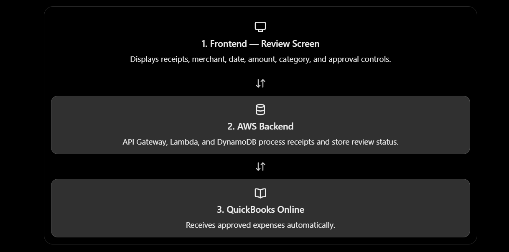

# Tallyfold — Receipts, Reconciled

<div align="center">

[](https://react.dev/)
[](https://www.typescriptlang.org/)
[](https://vitejs.dev/)
[](https://aws.amazon.com/)
[](https://developer.intuit.com/)
[](#apple-design-system--uiux)

**Automated receipt capture, OCR verification, and ledger reconciliation pipeline bridging physical expenses into QuickBooks Online.**

</div>

---

## Architecture Overview

Tallyfold operates across three decoupled tiers: a modern fluid frontend, a serverless AWS receipt processing backend, and Intuit QuickBooks Online.

<div align="center">
  
</div>

### Interactive Flowchart

```mermaid
flowchart TD
    subgraph Tier1["🖥️ 1. Frontend — Review Screen (AWS Amplify Hosting)"]
        UI_Dash["Dashboard &amp; Metrics<br/>(Spend Breakdown, Category Bars, KPI Cards)"]
        UI_Review["Review Queue &amp; Inspection Sheet<br/>(Live OCR Confidence, Eligibility Checklist)"]
        UI_Upload["AirDrop-style Upload Dropzone<br/>(Step Pipeline &amp; File Validation)"]
    end

    subgraph TierProxy["🛡️ Server-Side Proxy Layer"]
        Proxy["Amplify 200 Rewrite / Lambda Proxy<br/>(Strips /api, injects x-api-key &amp; x-review-token)"]
    end

    subgraph Tier2["🗄️ 2. AWS Backend Pipeline"]
        APIGW["Amazon API Gateway REST API (/prod)<br/>(GET /expenses · POST /upload · POST /review)"]
        S3["Amazon S3 Private Bucket<br/>(Presigned PUT with x-amz-meta-* binding)"]
        OCR["AWS Lambda + Tesseract OCR<br/>(Extracts Merchant, Date, Total, Tax, Category)"]
        DDB["Amazon DynamoDB<br/>(Key: userId / SK: date#receiptId · State Machine)"]
    end

    subgraph Tier3["📖 3. QuickBooks Online (Sandbox)"]
        QBO_API["Intuit QBO Accounting API"]
        QBO_Ledger["Sandbox Expense Register<br/>(Account 35 · Checking Ledger)"]
    end

    UI_Review -->|1. GET /api/expenses &amp; POST /api/review| Proxy
    UI_Upload -->|2. POST /api/upload| Proxy
    Proxy -->|3. Forward with x-api-key &amp; x-review-token| APIGW
    APIGW -->|4. Generate Presigned S3 PUT URL| S3
    UI_Upload -.->|5. Direct Browser-to-S3 Upload (Presigned)| S3
    S3 -->|6. S3 ObjectCreated Trigger| OCR
    OCR -->|7. Store Extracted Data (NEEDS_REVIEW)| DDB
    APIGW -->|8. Validate Review Token &amp; Dispatch| DDB
    DDB -->|9. Async Ledger Sync (PENDING → SYNCED)| QBO_API
    QBO_API -->|10. Verified Expense Entry| QBO_Ledger

    classDef screen fill:#18181b,stroke:#027a75,stroke-width:2px,color:#f4f4f5;
    classDef proxy fill:#18181b,stroke:#8b5cf6,stroke-width:2px,color:#f4f4f5;
    classDef aws fill:#18181b,stroke:#f59e0b,stroke-width:2px,color:#f4f4f5;
    classDef qbo fill:#18181b,stroke:#22c55e,stroke-width:2px,color:#f4f4f5;
    class Tier1 screen;
    class TierProxy proxy;
    class Tier2 aws;
    class Tier3 qbo;
```

---

## The Three Tiers & Proxy Architecture

### 1. Frontend — Review & Inspection Screen (AWS Amplify Hosting)
- **Role**: Client interface where finance teams review, audit, and approve receipts before they hit accounting books.
- **Key Capabilities**:
  - **Live OCR Confidence Gauge**: Color-coded meter indicating document readability and extraction certainty.
  - **Eligibility Verification Checklist**: Inline validation confirming status is `NEEDS_REVIEW`, confidence is $\ge 75\%$, currency is `USD`, account is `Checking 35`, and category is approved.
  - **Slide-over Sheet Drawer**: Non-modal inspection sheet with keyboard accessibility (`Esc` dismiss) and smooth Apple spring animation.
  - **Multi-attribute Filtering & Sorting**: Real-time text search, quick status chips, date range filtering, column-based sorting, and instant CSV export.
  - **Zero-secret Client Model**: Never stores `API_KEY` or `REVIEW_TOKEN` in client code, bundle, or `VITE_` variables.

### 2. Secure Production Proxy Layer (`/proxy`)
- **Role**: Bridges the static Amplify frontend with the secured AWS API Gateway REST API.
- **Why It Is Needed**:
  - `vite.config.ts` dev gateway runs only in local development (`vite`) and is omitted from static production builds (`dist/`).
  - API Gateway requires `x-api-key` for endpoints like `GET /expenses`, and the review Lambda requires `x-review-token` for `POST /review`.
  - Static hosting (AWS Amplify) cannot inject custom server-side request headers or modify request bodies on reverse-proxy rules.
- **How It Works**:
  - A lightweight Lambda handler ([proxy/handler.js](./proxy/handler.js)) running on `nodejs24.x` with Function URL.
  - Dynamically retrieves `API_KEY` and `REVIEW_TOKEN` at runtime from AWS Systems Manager (SSM) Parameter Store `SecureString` parameters (`/expense/proxy/api_key` and `/expense/proxy/review_token`). Secrets are never stored in CloudFormation templates, parameters, or git.
  - Caches parameter values in-memory across warm Lambda invocations.
  - Receives requests at `/api/expenses`, `/api/upload`, and `/api/review`.
  - Strips the `/api` prefix exactly once and preserves the `/prod` stage path.
  - Injects `x-api-key` header server-side.
  - Injects `x-review-token` header server-side on `POST /review` without mutating client payloads.
  - Handles CORS preflight (`OPTIONS` $\to$ 204 No Content) natively at Function URL and handler levels.
  - **Access Control Note**: CORS origin lockdown defaults to `https://main.d7hymcw027vmv.amplifyapp.com`. CORS provides browser-level domain restrictions for basic abuse prevention; it does not authenticate users (real user authentication requires Amazon Cognito JWT tokens). `PROXY_SECRET` is kept disabled/empty by default because Amplify rewrites cannot inject custom headers.

### 3. AWS Backend Pipeline & QuickBooks Online
- **Amazon S3**: Stores raw receipt images. Client performs direct browser-to-S3 upload using the presigned URL returned by `POST /api/upload`.
- **AWS Lambda + Tesseract OCR**: Automatically parses receipt details into DynamoDB.
- **Amazon DynamoDB**: Maintains receipt state:
  $$\text{NEEDS\_REVIEW} \longrightarrow \text{PENDING} \longrightarrow \text{SYNCING} \longrightarrow \text{SYNCED} \quad (\text{or } \text{FAILED})$$
- **QuickBooks Online**: Receives approved expenses and registers them in the Sandbox general ledger.

---

## AWS Amplify Production Setup

### Step 1: Create SecureString Parameters in AWS Systems Manager

Before deploying the proxy, store the API Gateway API key and review token in AWS Systems Manager Parameter Store in `eu-north-1`. This keeps secrets completely out of source code, git commits, and CloudFormation parameter files:

1. Open the **AWS Systems Manager Console** and select region **`eu-north-1` (Stockholm)**.
2. In the navigation pane, choose **Parameter Store**, then click **Create parameter**.
3. Create the **API Key** parameter:
   - **Name**: `/expense/proxy/api_key`
   - **Type**: `SecureString`
   - **KMS key source**: `My current account` (uses the default AWS managed key `alias/aws/ssm`)
   - **Value**: Enter your API Gateway API key.
   - Click **Create parameter**.
4. Create the **Review Token** parameter:
   - **Name**: `/expense/proxy/review_token`
   - **Type**: `SecureString`
   - **KMS key source**: `My current account` (uses the default AWS managed key `alias/aws/ssm`)
   - **Value**: Enter your secret review token.
   - Click **Create parameter**.

> **Security Note**: The Lambda execution role defined in [`proxy/template.yaml`](./proxy/template.yaml) is strictly granted `ssm:GetParameter` on only these two parameter ARNs in `eu-north-1`. It has no access to any other SSM parameters or AWS services.

### Step 2: Deploy the Proxy Function

Deploy the serverless proxy via the included SAM / CloudFormation template ([proxy/template.yaml](./proxy/template.yaml)). No secret values need to be passed on the command line:

```bash
# Using AWS SAM CLI:
sam deploy --template-file proxy/template.yaml \
  --stack-name tallyfold-proxy \
  --capabilities CAPABILITY_IAM \
  --parameter-overrides \
    AllowedOrigin=https://main.d7hymcw027vmv.amplifyapp.com
```

This returns a `ProxyFunctionUrl` (e.g. `https://<unique-id>.lambda-url.eu-north-1.on.aws/`).

### Step 3: Configure Amplify Hosting Rewrites

In the **AWS Amplify Console**:
1. Navigate to **Hosting** &rarr; **Rewrites and redirects**.
2. Click **Manage redirects** and enter the following rules (ensure the `/api/<*>` rule is **above** the SPA catch-all rule):

```json
[
  {
    "source": "/api/<*>",
    "target": "https://<unique-id>.lambda-url.eu-north-1.on.aws/api/<*>",
    "status": "200",
    "condition": null
  },
  {
    "source": "</^[^.]+$|\\.(?!(css|gif|ico|jpg|js|png|txt|svg|woff|woff2|ttf|map|json)$)([^.]+$)+>",
    "target": "/index.html",
    "status": "200",
    "condition": null
  }
]
```

*Result*: The client browser calls `/api/*` on the same domain, Amplify proxies requests to the Lambda function, and the function injects authorization credentials before forwarding to API Gateway.

---

## Apple Design System & UI/UX

The interface was built according to the **Apple Design Guidelines** ([SKILL.md](./SKILL.md)):

- **Translucent Materials & Depth (§12)**:
  - Header, slide-over drawer, and notifications use `backdrop-filter: blur(24px) saturate(190%)` frosted glass styling.
  - Hairline borders (`rgba(0, 0, 0, 0.08)` / `rgba(255, 255, 255, 0.09)`) and layered ambient elevation shadows.
- **Fluid Motion & Latency Elimination (§1, §3, §4)**:
  - Immediate `:active` tactile downstate (`transform: scale(0.965); transition: transform 90ms ease-out;`).
  - Critically damped spring physics (`cubic-bezier(0.25, 1, 0.5, 1)`).
  - Sheet grab-handle indicator at the top of the detail drawer for spatial familiarity.
- **Optical Typography (§15)**:
  - Native system typography stack (`-apple-system, BlinkMacSystemFont, "SF Pro Display", "SF Pro Text"`).
  - Negative letter-tracking on display headings, positive tracking on micro badges, and `tabular-nums` on monetary figures.
- **Accessibility & Adaptive Preferences (§14)**:
  - Full support for `prefers-reduced-motion`, `prefers-reduced-transparency`, and `prefers-contrast`.

---

## Quickstart & Local Development

### Installation & Run

```bash
# 1. Install dependencies
npm install

# 2. Configure environment
cp .env.example .env
# Fill in API_KEY and REVIEW_TOKEN in .env

# 3. Start development server
npm run dev
# Open http://localhost:5173
```

### Run Tests & Production Build

```bash
# Run all unit tests (lib, client error handling, proxy forwarding, auth)
npm test

# Type-check and create production bundle in dist/
npm run build
```

### Portal Access Credentials

The web application includes an Apple-themed authentication portal:
- **Username**: `user`
- **Password**: `qwer1234`

---

## Directory Structure

```text
tallyfold/
├── docs/
│   └── architecture.png       # 3-tier architecture diagram
├── proxy/
│   ├── handler.js             # AWS Lambda production proxy handler
│   ├── server.js              # Standalone Node.js proxy server
│   ├── template.yaml          # AWS CloudFormation / SAM deployment template
│   ├── package.json           # Lambda dependencies (@aws-sdk/client-ssm)
│   └── proxy.test.ts          # Proxy unit tests (stripping, headers, review adaptation)
├── public/
│   ├── favicon.svg            # Apple squircle vector brand icon
│   └── architecture.png
├── src/
│   ├── api.ts                 # Backend HTTP client with descriptive error handling
│   ├── api.test.ts            # Client error handling tests (404, 403, CORS, network)
│   ├── App.tsx                # Application shell, routing & views
│   ├── auth.ts / auth.tsx     # Authentication context, session management & route guard
│   ├── auth.test.ts           # Authentication logic unit tests
│   ├── lib.ts                 # Formatting, sorting, CSV export & review rules
│   ├── lib.test.ts            # Unit tests for normalization & validation
│   ├── LoginPage.tsx          # Apple fluid glassmorphic authentication screen
│   ├── main.tsx               # React DOM bootstrap
│   ├── styles.css             # Apple Fluid Design System & CSS variables
│   ├── theme.tsx              # Theme provider (Light / Dark / System)
│   └── toast.tsx              # Dynamic Island style notification system
├── index.html                 # App shell with Apple meta tags & fonts
├── package.json               # Dependencies & build scripts
├── SKILL.md                   # Apple Design Guidelines & motion principles
├── tsconfig.json              # TypeScript compiler configuration
└── vite.config.ts             # Vite dev server & secure API proxy gateway
```

---

## License

MIT © [Tallyfold](https://github.com/naman1326/tallyfold)
